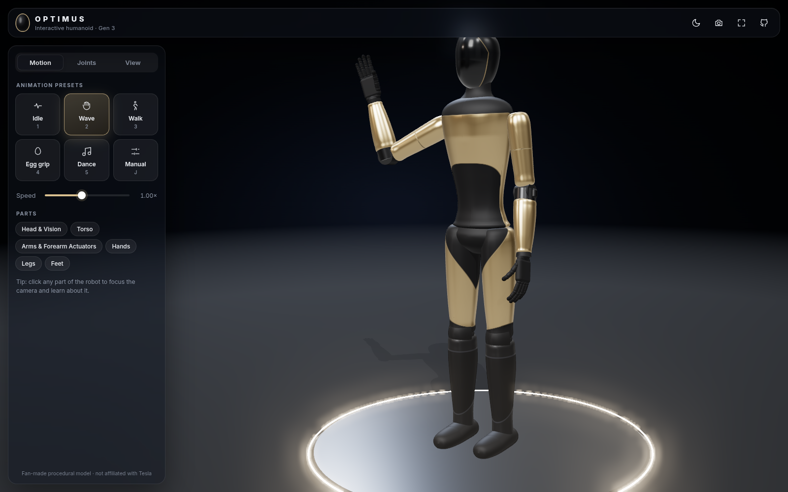
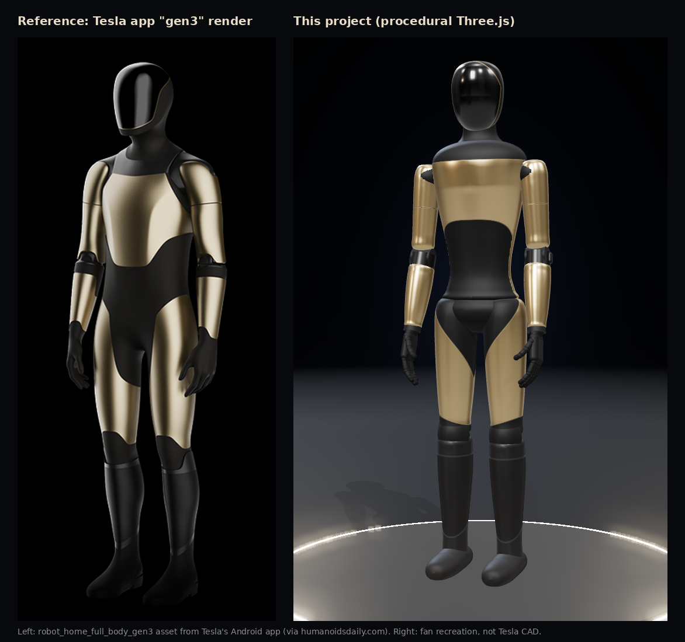
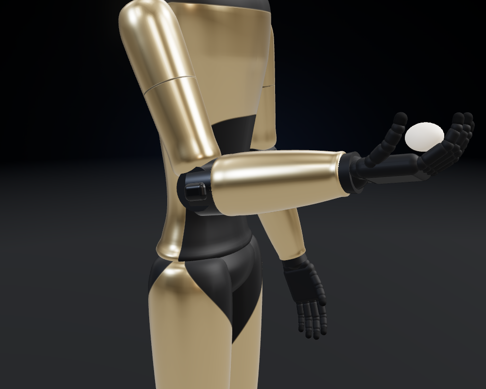
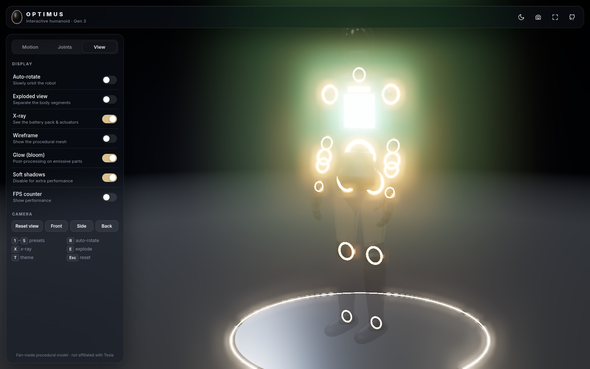
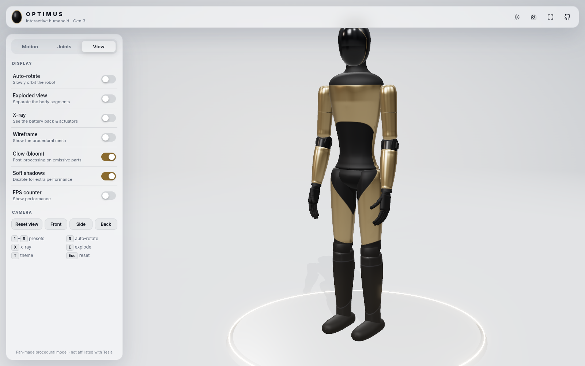

# Optimus Gen 3 · Interactive 3D

An interactive 3D **fan recreation of Tesla's Optimus Gen 3** humanoid robot that runs in the browser. It's built with **Three.js** and **Vite**, and every part is made in code from Three.js geometry (spline lathes, capsules, rounded boxes). There are no downloaded models or paid assets.

### 🔗 [Live demo →](https://russellambriz.github.io/optimus-3d-interactive/)



## What it's based on

As of October 2026, Tesla has **not** formally unveiled Optimus Gen 3. The most recent Tesla-made images of it are the `gen3` robot renders shipped inside Tesla's own Android app (for example `robot_home_full_body_gen3.png`, first seen in build 4.60.0 on Aug 27, 2026). This model is a recreation of those renders, built by eye from public images. **It is not Tesla's CAD**, and proportions and details are approximate.



What the model copies from the Gen 3 renders:

- **Finish:** satin champagne-gold metal panels and matte black "suit" areas. No white.
- **Head:** an all-black egg-shaped head with a mirror-gloss faceplate, a satin back shell and a thin gold pinstripe around the face.
- **Neck and torso:** a tall black neck flowing into a black yoke over the shoulders. Below it, a flat-topped gold chest plate with gold flanks, then a black abdomen that runs through the crotch and down the inner thighs.
- **Arms:** gold shoulder caps that continue into the upper arm, with a single panel seam. A matte black elbow band with a small ridge, and a **bulky gold forearm**: Gen 3 moves the hand's actuators into the forearm.
- **Hands:** black, human-proportioned hands with an opposable thumb (15 jointed segments per hand).
- **Legs:** enclosed hips, gold thighs, black kneepads, and matte black boot-style lower legs with a cuff line and a slanted ankle seam, ending in boot-like feet.

Sources:

- [Humanoids Daily: Tesla app contains Optimus Gen 3 renders](https://www.humanoidsdaily.com/news/tesla-app-optimus-gen3-renders)
- [Teslarati: Optimus Gen 3 app discovery](https://www.teslarati.com/tesla-optimus-gen-3-shows-off-a-cleaner-factory-ready-design-in-new-app-discovery/)
- [Electric-Vehicles.com: Tesla patents on the Gen 3 forearm and hand](https://eletric-vehicles.com/tesla/tesla-files-patents-revealing-optimus-gen-3-mechanical-blueprint/)
- [Droids Substack: "The Forearm Is the New Hand"](https://droids.substack.com/p/the-forearm-is-the-new-hand-inside)

| Egg grip | X-ray | Light theme |
|---|---|---|
|  |  |  |

## Features

- **Procedural Gen 3 model** with a custom two-tone PBR shader. Each shell switches between gold and matte or gloss black using masks in object space, with crisp panel seams. This gives the smooth, one-piece look of Gen 3 without any textures.
- **Full joint hierarchy:** pelvis → waist → chest → neck/head, shoulders → elbows → wrists → fingers/thumb, hips → knees → ankles → toes. Feet stay on the ground automatically.
- **Animation presets** that blend smoothly into each other: Idle (breathing), Wave, Walk cycle, Egg grip, Dance, plus Manual mode.
- **Manual joint sliders** for the head, torso, both arms (including wrist twist and grip) and both legs.
- **Click any part** and the camera flies to it while a glass info card explains it. Facts are sourced, and anything unconfirmed is marked *reported*, for example the 22-DoF hand and the 25 actuators per forearm and hand.
- **Hover highlight** with a tooltip.
- **View modes:** auto-rotate, exploded view, X-ray (a stylized battery pack plus glowing actuator rings, including the forearm actuator pack), wireframe, and light/dark theme.
- **Rendering:** `MeshPhysicalMaterial`, `RoomEnvironment` + PMREM image-based lighting, soft PCF shadows, ACES filmic tone mapping, selective-threshold bloom, 4× MSAA and a studio backdrop with a glowing platform.
- **UI:** glassmorphism panels, Inter typography, eased transitions, a loading screen and keyboard shortcuts. On mobile it uses a bottom-sheet panel and touch orbit/pinch zoom.
- **Performance:** cached/shared geometries, an instanced battery-cell mesh, capped pixel ratio and a single shadow map (2048², or 1024² on mobile).

### Keyboard shortcuts

| Key | Action |
|---|---|
| `1`–`5` | Idle / Wave / Walk / Egg grip / Dance |
| `J` | Manual joint mode |
| `R` | Toggle auto-rotate |
| `E` | Exploded view |
| `X` | X-ray |
| `W` | Wireframe |
| `T` | Light / dark theme |
| `P` | Save a PNG screenshot |
| `Esc` | Clear selection and reset the camera |

## Run locally

Requires Node.js 18+.

```bash
git clone https://github.com/russellambriz/optimus-3d-interactive.git
cd optimus-3d-interactive
npm install
npm run dev        # http://localhost:5173
```

Production build:

```bash
npm run build      # outputs static files to dist/
npm run preview    # serves dist/ at http://localhost:4173/optimus-3d-interactive/
```

### URL parameters (handy for demos)

`?preset=wave|walk|grip|dance` · `?theme=light` · `?xray` · `?explode` · `?part=hand`

## Project structure

```
src/
  robot.js      procedural geometry, materials, joint hierarchy, posing
  animation.js  rest pose, slider definitions, animation preset functions
  parts.js      info-card content
  main.js       renderer, lighting, post-processing, picking, UI wiring
  style.css     glass UI
.github/workflows/deploy.yml   builds and deploys to GitHub Pages
```

## Deployment

Every push to `main` runs the GitHub Actions workflow, which builds the site with Vite and publishes `dist/` to GitHub Pages. The Vite `base` is set to `/optimus-3d-interactive/`.

## Notes and disclaimer

This is a fan-made educational project and is not affiliated with or endorsed by Tesla. The model is an artistic recreation of Tesla's publicly visible Gen 3 app renders, built by eye. It is not Tesla CAD, and the final production robot may look different.

Figures in the info cards come from Tesla's public statements and filings: AI Day 2022, the Gen 2 reveal in Dec 2023, Elon Musk's Nov 2025 post on forearm actuators, and Tesla's April 2026 patent publications. Anything not officially confirmed is labeled "reported" or "illustrative."

## License

MIT
