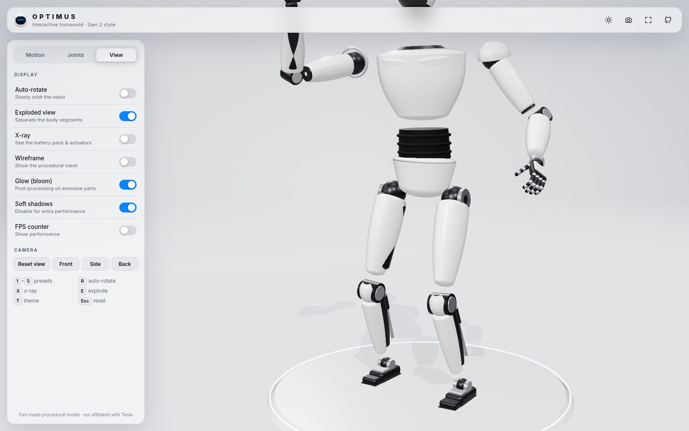

# Optimus · Interactive 3D

An interactive 3D model of Tesla's **Optimus** humanoid robot (Gen 2 style) that runs in the browser. It's built with **Three.js** and **Vite**. Every part of the robot is made in code from Three.js geometry (lathes, capsules, rounded boxes), so there are no downloaded models or paid assets.

### 🔗 [Live demo →](https://russellambriz.github.io/optimus-3d-interactive/)


| Egg grip | X-ray | Exploded (light theme) |
|---|---|---|
|  |  |  |

## Features

- **Procedural robot model:** white clearcoat body panels, a glossy black face visor with a soft light bar, graphite joints, satin-metal accents, calf linear-actuator rods, jointed toes, and hands with 5 fingers and 15 finger joints each.
- **Full joint hierarchy:** pelvis → waist → chest → neck/head, shoulders → elbows → wrists → fingers/thumb, hips → knees → ankles → toes. Feet stay on the ground automatically, even when squatting or walking.
- **Animation presets** that blend smoothly into each other: Idle (breathing), Wave, Walk cycle, Egg grip, Dance, plus Manual mode.
- **Manual joint sliders** for the head, torso, both arms (including wrist twist and grip) and both legs.
- **Click any part** (head, torso, arms, hands, legs, feet) and the camera flies over to it with easing. A glass info card explains what that part does, with sources and approximate figures labeled.
- **Hover highlight** with a tooltip.
- **View modes:** auto-rotate, exploded view, X-ray (shows a stylized battery pack and glowing actuator rings), wireframe, and light/dark theme.
- **Rendering:** PBR `MeshPhysicalMaterial`, `RoomEnvironment` + PMREM image-based lighting, soft PCF shadows, ACES filmic tone mapping, selective-threshold bloom, 4× MSAA and a studio gradient backdrop with a glowing platform.
- **UI:** glassmorphism panels, Inter typography, eased transitions, a loading screen and keyboard shortcuts. On mobile it uses a bottom-sheet panel and touch orbit/pinch zoom.
- **Performance:** cached/shared geometries, an instanced battery-cell mesh, capped pixel ratio, a single 2048² shadow map (1024² on mobile) and an optional FPS counter.

### Keyboard shortcuts

| Key | Action |
|---|---|
| `1`–`5` | Idle / Wave / Walk / Egg grip / Dance |
| `J` | Manual joint mode |
| `R` | Toggle auto-rotate |
| `E` | Exploded view |
| `X` | X-ray |
| `W` | Wireframe |
| `T` | Light / dark theme |
| `P` | Save a PNG screenshot |
| `Esc` | Clear selection and reset the camera |

## Run locally

Requires Node.js 18+.

```bash
git clone https://github.com/russellambriz/optimus-3d-interactive.git
cd optimus-3d-interactive
npm install
npm run dev        # http://localhost:5173
```

Production build:

```bash
npm run build      # outputs static files to dist/
npm run preview    # serves dist/ at http://localhost:4173/optimus-3d-interactive/
```

### URL parameters (handy for demos)

`?preset=wave|walk|grip|dance` · `?theme=light` · `?xray` · `?explode` · `?part=hand`

## Project structure

```
src/
  robot.js      procedural geometry, materials, joint hierarchy, posing
  animation.js  rest pose, slider definitions, animation preset functions
  parts.js      info-card content
  main.js       renderer, lighting, post-processing, picking, UI wiring
  style.css     glass UI
.github/workflows/deploy.yml   builds and deploys to GitHub Pages
```

## Deployment

Every push to `main` runs the GitHub Actions workflow, which builds the site with Vite and publishes `dist/` to GitHub Pages. The Vite `base` is set to `/optimus-3d-interactive/`.

## Notes and disclaimer

This is a fan-made educational project and is not affiliated with or endorsed by Tesla. The model is an artistic approximation built from public photos. The figures in the info cards come from Tesla's public presentations: AI Day 2022, the Gen 2 reveal in Dec 2023, and later demos. Anything not officially confirmed is labeled "reported" or "illustrative."

## License

MIT
